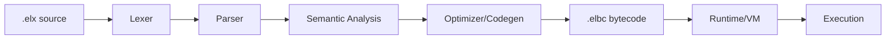

# Architecture (Public SDK view)

## Pipeline (conceptual; verify against source)

Implementation: `compiler/src/{lexer,parser,semantic,optimizer,elbc}.c`, `runtime/src/{elbc_reader,vm,stack,arena,runtime,elx_stdlib}.c`.

## SDK components
- **CLI:** `cli/elx.c` (build/run/test/init/doctor/version/help/module/package/diag/fmt/lint/debug/freeze/compat/rc/stabilize/release)
- **Core:** diagnostics, formatter, linter, debugger, module/package, spec_freeze/compat/elx1
- **Stdlib:** C headers in `include/elx_std_*.h`, implementations in `std/` and runtime bindings
- **Native/Security:** `native/`, `security/`
- **Platforms:** `platforms/linux|macos|windows/`

## Boundary
This repository documents the **public ELX SDK toolchain**. Private ELVI OS internals (GUI/kernel/drivers/services/internal AI/ELVI-specific bridges) are not part of this public SDK.
